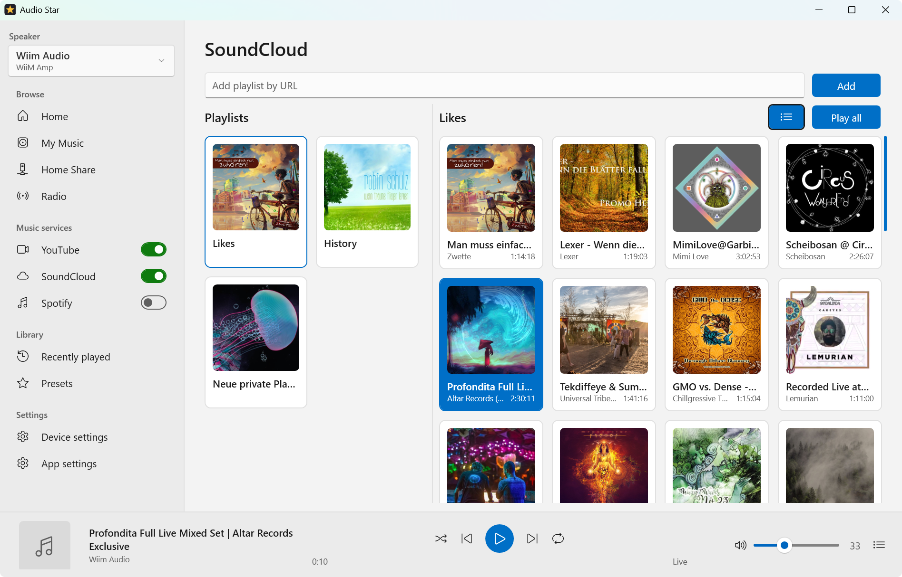

# Audio Star

By [Alexander Kastil](https://www.linkedin.com/in/alexander-kastil/)

Audio Star is a Windows desktop app that replaces the WiiM Home app for WiiM and LinkPlay speakers. It plays music from YouTube, SoundCloud, Spotify, internet radio and your PC.

- Finds speakers on your network through discovery or a manual IP address, and shows what is playing and the queue.
- Plays YouTube and SoundCloud playlists from a pasted URL. The speaker never sees the YouTube or SoundCloud URLs; the PC fetches the streams for it.
- Plays Spotify playlists through Spotify Connect, with your own Spotify app client ID.
- Plays internet radio stations from the radio-browser.info directory.
- Plays music from folders on your PC, served to the speaker by Audio Star.
- Optionally shares your music as a DLNA media server.



## Prerequisites

- A 64-bit Windows PC on the same local network as the speakers.
- One or more WiiM or LinkPlay speakers.
- Inbound access for TCP ports 22534 and 22545 and UDP port 1900, from the local subnet on private networks. The installer adds these rules. When you run from source, use the firewall script in Getting Started.
- ffmpeg on your `PATH`, for SoundCloud HLS streams, which Audio Star converts to FLAC with it. Install it yourself, for example with `choco install ffmpeg`.
- yt-dlp is not required. Audio Star downloads its own copy from GitHub when it starts and keeps it updated.
- A Spotify client ID for Spotify playback. Create an app at developer.spotify.com, add the redirect URI shown on the App settings page, and paste the client ID into App settings.
- To build from source: the .NET 10 SDK, and WiX v6 for the installer. The installer ships a self-contained build, so an installed copy needs no .NET runtime.

## Getting Started

1. Clone this repository and install the .NET 10 SDK.
2. Build the app:

```powershell
dotnet build src/audio-start/AudioStar.Desktop/AudioStar.Desktop.csproj
```

3. If you run from source, open the firewall once from an elevated PowerShell:

```powershell
pwsh -ExecutionPolicy Bypass -File src/audio-start/tools/firewall.ps1
```

4. Start the app. Add `--autostart` to start it hidden in the system tray.

```powershell
src/audio-start/AudioStar.Desktop/bin/Debug/net10.0-windows/AudioStar.exe
```

5. In App settings, add your music folders. Enter a speaker's IP address if discovery does not find it. Add your Spotify client ID and SoundCloud profile URL to use those sources.
6. To build the installer, run the command below. It writes `setup/AudioStar.msi`. The per-machine install adds the firewall rules and offers a "Start with Windows" option.

```powershell
dotnet build src/audio-start/AudioStar.Setup/AudioStar.Setup.wixproj -c Release
```

## Contributing

Feel free to contribute. When contribute implement your changes / additions on a feature branch in your fork and issue a pull request after completion. An introduction video into forks and pull requests can be found [here](https://www.youtube.com/watch?v=nT8KGYVurIU)

## License & Re-Use

Copyright (c) 2026 Alexander Kastil / integrations.at. All rights reserved. These materials are proprietary and are **not** open-source or Creative Commons. Use is governed by the [LICENSE](LICENSE) file; the summary below is for convenience only and does not modify it.

- Personal Use only: a natural person may use the materials for their own private self-study, free of charge.
- Any use by or for a business, public body, school, university, association, or non-profit organization is prohibited without a paid written license. This includes learning partners, training providers, consultancies, and employers.
- Delivering the materials as a training, workshop, or course by any trainer or learning partner is prohibited without a paid written license, **whether the delivery is paid or free of charge, and whether the deliverer is for-profit or non-profit**.
- Redistribution, publication, hosting, and distribution of derivative works are not permitted.
- Governed by Austrian law; exclusive place of jurisdiction is Vienna, Austria (see the LICENSE for the full terms).

Participation in this project is also governed by the [Code of Conduct](CODE_OF_CONDUCT.md).

For a commercial, non-profit, or training license, contact the author via [LinkedIn](https://www.linkedin.com/in/alexander-kastil/) or [email](mailto:alexander.kastil@integrations.at).
